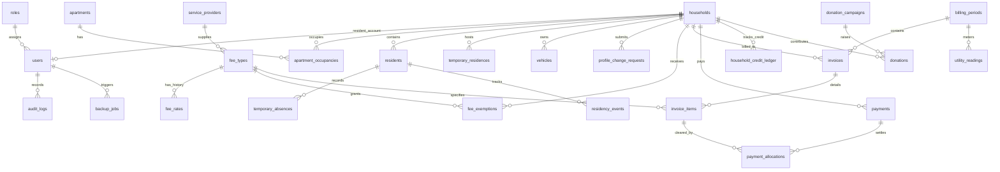

# 📘 TÀI LIỆU ĐẶC TẢ CƠ SỞ DỮ LIỆU BLUE MOON (DATABASE SPECIFICATION)

> **Dành cho:** Toàn bộ đội ngũ phát triển Backend, Frontend & QA (Nhóm 18 - BlueMoon Management System).
> **Hệ quản trị CSDL:** **PostgreSQL 15+** (Khuyến nghị 16).
> **File mã nguồn DDL:** [01_schema.sql](file:///home/hotboyhust/project/bluemoon-management-system/01_schema.sql) (hoặc [database/01_schema.sql](file:///home/hotboyhust/project/bluemoon-management-system/database/01_schema.sql)).
> **Hợp đồng API tương ứng:** [bluemoon.yaml](file:///home/hotboyhust/project/bluemoon-management-system/bluemoon.yaml).
> **Phiên bản tài liệu:** v1.1 (Cập nhật đồng bộ theo chuẩn 47 User Stories).

---

## 📑 MỤC LỤC
1. [Nguyên tắc thiết kế & Ràng buộc nghiệp vụ cốt lõi](#1-nguyên-tắc-thiết-kế--ràng-buộc-nghiệp-vụ-cốt-lõi)
2. [Sơ đồ kiến trúc & Phân nhóm 28 bảng dữ liệu](#2-sơ-đồ-kiến-trúc--phân-nhóm-28-bảng-dữ-liệu)
   - [Phân hệ 1: Người dùng, Phân quyền RBAC & Hệ thống](#phân-hệ-1-người-dùng-phân-quyền-rbac--hệ-thống)
   - [Phân hệ 2: Căn hộ, Hộ gia đình, Nhân khẩu & Cư trú](#phân-hệ-2-căn-hộ-hộ-gia-đình-nhân-khẩu--cư-trú)
   - [Phân hệ 3: Danh mục phí, Kỳ thu, Giấy báo & Quầy thu ngân](#phân-hệ-3-danh-mục-phí-kỳ-thu-giấy-báo--quầy-thu-ngân)
   - [Phân hệ 4: Quỹ vận động đóng góp tự nguyện](#phân-hệ-4-quỹ-vận-động-đóng-góp-tự-nguyện)
3. [Danh mục các Database Views & Mục đích sử dụng](#3-danh-mục-các-database-views--mục-đích-sử-dụng)
4. [Hướng dẫn kỹ thuật dành cho Backend Developer](#4-hướng-dẫn-kỹ-thuật-dành-cho-backend-developer)
5. [Hướng dẫn kỹ thuật dành cho Frontend Developer](#5-hướng-dẫn-kỹ-thuật-dành-cho-frontend-developer)
6. [Bảng tra cứu nhanh thực thể CSDL (Data Dictionary)](#6-bảng-tra-cứu-nhanh-thực-thể-csdl-data-dictionary)

---

## 1. NGUYÊN TẮC THIẾT KẾ & RÀNG BUỘC NGHIỆP VỤ CỐT LÕI

Khi xây dựng mã nguồn Backend (FastAPI / SQLAlchemy) hay giao diện Frontend (React / Vue), tất cả thành viên bắt buộc phải nắm vững 7 nguyên tắc bất biến:

1. **Không xóa vật lý dữ liệu nghiệp vụ (No Hard Delete):**
   * Các bảng tài chính (`payments`, `donations`), nhân khẩu (`residents`), căn hộ, khoản thu tuyệt đối không dùng câu lệnh `DELETE FROM`.
   * Thao tác "xóa" bản chất là cập nhật trạng thái (`status = 'INACTIVE'`, `is_deleted = true`, hoặc `status = 'CANCELLED'`). Bảng `audit_logs`, `payments`, `donations` đều có Database Trigger chặn cứng lệnh `DELETE`.
2. **Tách biệt Căn hộ vật lý (`apartments`) và Hộ cư trú (`households`):**
   * `apartments`: Đại diện cho diện tích sàn, tầng, mã căn cố định (VD: `A1204`).
   * `households`: Đại diện cho nhóm nhân khẩu đang sinh sống.
   * Khi chuyển nhượng/đổi chủ (`US-02`, `US-03`), hệ thống không sửa đè thông tin căn hộ mà đóng dòng cư trú cũ tại bảng `apartment_occupancies` và mở dòng mới cho hộ mới. Việc này bảo toàn 100% lịch sử công nợ của chủ cũ.
3. **Bất biến lịch sử tài chính (Snapshotting):**
   * Đơn giá khoản thu và diện tích căn hộ được sao chép cứng (snapshot) vào bảng `invoices` và `invoice_items` tại thời điểm tạo kỳ thu. Nếu sau này kế toán đổi giá dịch vụ tại `fee_rates`, các hóa đơn kỳ cũ không bị nhảy lại số tiền.
4. **Sổ cái số dư có hai chiều (Double-Entry Credit Ledger):**
   * Khi hộ dân nộp thừa tiền (`credit_amount > 0`), hệ thống không cập nhật đơn thuần vào một cột số học mà ghi nhận vào bảng `household_credit_ledger`. Sổ cái này ghi rõ tiền sinh ra từ biên lai nào (`OVERPAYMENT`) và được bù trừ vào hóa đơn nào (`APPLIED`).
5. **Đơn vị tiền tệ và chuẩn ngày giờ:**
   * **Tiền tệ:** Trong CSDL lưu trữ kiểu `NUMERIC(14,2)` để đảm bảo độ chính xác tài chính, nhưng nghiệp vụ hệ thống luôn làm tròn đến đồng chẵn (VNĐ). Các trường tiền trả qua API ở dạng số nguyên `int64`.
   * **Ngày tháng:** Kiểu `date` định dạng `YYYY-MM-DD`. Kỳ thu hàng tháng luôn lưu ngày đầu tháng: `YYYY-MM-01`.
   * **Thời điểm:** Kiểu `timestamptz` chuẩn ISO 8601 kèm múi giờ Việt Nam (`+07:00`).
6. **Chống trùng lặp giao dịch (Idempotency) & Sinh số chứng từ liên tục:**
   * `payments.idempotency_key` lưu UUID từ client gửi lên để chặn nhấn đúp tạo biên lai trùng (`NFR-008`).
   * Số biên lai (`BL00000001`) và phiếu thu quỹ (`QT00000001`) sinh tự động qua bảng `document_counters` với cơ chế khóa dòng (Row-level Lock) trong Transaction, đảm bảo tuyệt đối không bị nhảy số hay hổng số khi nhiều thu ngân thao tác đồng thời.
7. **Bảo mật phân quyền & Chống IDOR:**
   * Hệ thống có 4 vai trò: `ADMIN` (Trưởng BQT), `ACCOUNTANT` (Kế toán), `TREASURER` (Thủ quỹ), `RESIDENT` (Cư dân).
   * Cư dân chỉ được xem dữ liệu qua các endpoint `/portal/*`. Backend tự động lấy `household_id` từ JWT Token của cư dân, không nhận tham số hộ từ client để triệt tiêu lỗ hổng IDOR (`AC-44.2`).

---

## 2. SƠ ĐỒ KIẾN TRÚC & PHÂN NHÓM 28 BẢNG DỮ LIỆU



---

### PHÂN HỆ 1: NGƯỜI DÙNG, PHÂN QUYỀN RBAC & HỆ THỐNG
*Ánh xạ Epic: `EP-05` (Bảo mật & Người dùng), `EP-08` (Quản trị hệ thống & Sao lưu).*

#### 1. `roles` (Vai trò người dùng)
* Lưu danh mục 4 vai trò của tòa nhà chung cư.
* **Cột chính:** `id` (smallint, PK), `code` (text, UNIQUE: `ADMIN`, `ACCOUNTANT`, `TREASURER`, `RESIDENT`), `name`, `description`.

#### 2. `users` (Tài khoản người dùng)
* Lưu trữ tài khoản đăng nhập cho cả cán bộ BQT lẫn cư dân.
* **Cột chính:**
  * `id` (bigint, PK), `username` (text, lower case UNIQUE).
  * `password_hash` (text): Băm mật khẩu bằng thuật toán `bcrypt` (`US-44`).
  * `role_id` (smallint, FK $\rightarrow$ `roles.id`).
  * `household_id` (bigint, FK $\rightarrow$ `households.id`, NULL đối với nhân viên BQT). Có ràng buộc `UNIQUE` đảm bảo **mỗi hộ chỉ có duy nhất 1 tài khoản cư dân** (`D-12`).
  * `must_change_password` (boolean, DEFAULT true): Buộc đổi mật khẩu lần đầu (`AC-29.2`).
  * `failed_login_count` (smallint, DEFAULT 0), `locked_until` (timestamptz): Khóa tạm thời 15 phút khi nhập sai 5 lần liên tiếp (`AC-28.2`).
  * `is_active` (boolean, DEFAULT true): Khóa/mở khóa tài khoản thủ công (`US-30`).

#### 3. `audit_logs` (Nhật ký thao tác hệ thống)
* Lưu vết bất biến toàn bộ hành vi nhạy cảm (sửa giá, hủy biên lai, đổi chủ hộ, truy cập trái phép).
* **Cột chính:** `id` (bigint, PK), `user_id` (bigint, FK $\rightarrow$ `users.id`), `action` (text, VD: `UPDATE_FEE_RATE`, `CANCEL_PAYMENT`, `CHANGE_HEAD`), `entity_type` (text), `entity_id` (text), `old_value` (jsonb), `new_value` (jsonb), `ip_address`, `user_agent`, `created_at`.
* **Ràng buộc:** Trigger `trg_audit_logs_immutable` và `trg_audit_logs_no_truncate` cấm tiệt mọi thao tác `UPDATE`, `DELETE`, `TRUNCATE`.

#### 4. `document_counters` (Bộ đếm chứng từ tài chính)
* Quản lý số thứ tự tăng liên tục cho Biên lai thu phí và Phiếu thu quỹ.
* **Cột chính:** `counter_code` (text, PK: `RECEIPT`, `DONATION`), `last_no` (bigint, DEFAULT 0).
* **Hàm hỗ trợ:** `next_document_no(p_code)` dùng `UPDATE ... RETURNING` khóa dòng đến cuối transaction, đảm bảo khi rollback không bị mất số và nhiều thu ngân gọi đồng thời không bị trùng mã.

#### 5. `backup_jobs` (Lịch sử sao lưu CSDL)
* Phục vụ API giám sát sao lưu `US-45` cho Quản trị viên.
* **Cột chính:** `id` (bigint, PK), `status` (text: `QUEUED`, `RUNNING`, `SUCCEEDED`, `FAILED`), `requested_by` (bigint, FK $\rightarrow$ `users.id`, NULL nếu cronjob tự động lúc 02:00 sáng), `requested_at`, `finished_at`, `size_bytes`, `file_path`, `error_message`.

---

### PHÂN HỆ 2: CĂN HỘ, HỘ GIA ĐÌNH, NHÂN KHẨU & CƯ TRÚ
*Ánh xạ Epic: `EP-01` (Quản lý căn hộ & nhân khẩu), `EP-09` (Cổng cư dân & biến động).*

#### 6. `apartments` (Căn hộ vật lý)
* Lưu thông số vật lý cố định của căn hộ.
* **Cột chính:** `id` (bigint, PK), `code` (text, UNIQUE, VD: `A0502`, `B1204`), `floor` (smallint $\ge 0$), `area_m2` (numeric(8,2) $> 0$), `status` (`ACTIVE`, `INACTIVE`), `note`.

#### 7. `households` (Hộ gia đình)
* Thực thể hộ cư trú độc lập với căn hộ vật lý.
* **Cột chính:** `id` (bigint, PK), `household_code` (text, UNIQUE, VD: `H-A0502-01`), `status` (`ACTIVE`, `INACTIVE`), `contact_phone`, `contact_email`, `note`.

#### 8. `apartment_occupancies` (Lịch sử cư trú Căn hộ - Hộ)
* Bảng liên kết trung gian lưu vết hộ nào ở căn hộ nào trong khoảng thời gian nào.
* **Cột chính:** `id` (bigint, PK), `apartment_id` (FK), `household_id` (FK), `start_date`, `end_date` (NULL nếu đang ở), `end_reason`.
* **Ràng buộc:** `EXCLUDE USING gist (apartment_id WITH =, daterange(start_date, end_date, '[]') WITH &&)` chặn hoàn toàn lỗi nghiệp vụ: không thể có 2 hộ cùng cư trú tại 1 căn hộ trong cùng một ngày.

#### 9. `residents` (Nhân khẩu thường trú)
* Danh sách nhân khẩu trong hộ gia đình.
* **Cột chính:**
  * `id` (bigint, PK), `household_id` (FK $\rightarrow$ `households.id`).
  * `full_name` (text), `date_of_birth` (date), `gender` (`NAM`, `NU`, `KHAC`).
  * `cccd` (text, CHECK 9-12 chữ số, UNIQUE nếu không NULL và chưa xóa; trẻ em $< 14$ tuổi được phép để trống theo `AC-05.3`).
  * `is_head` (boolean): Đánh dấu chủ hộ. Ràng buộc `ux_residents_one_head` bảo đảm **mỗi hộ chỉ có đúng 1 chủ hộ đang hoạt động** (`AC-05.1`).
  * `residence_status` (`THUONG_TRU`, `TAM_VANG`, `DA_CHUYEN_DI`, `DA_QUA_DOI`).
  * `is_deleted` (boolean, DEFAULT false), `deleted_at`, `deleted_by`, `delete_reason`: Xóa logic theo `US-06`.

#### 10. `temporary_residences` (Khai báo Tạm trú)
* Dành cho người ngoài/khách vãng lai đến ở tạm thời tại căn hộ (`US-08`).
* **Cột chính:** `id` (bigint, PK), `household_id` (FK), `apartment_id` (FK), `full_name`, `cccd` (bắt buộc), `permanent_address` (địa chỉ thường trú gốc), `start_date`, `end_date`, `status` (`ACTIVE`, `EXPIRED`, `ENDED`). Ràng buộc `end_date > start_date`.

#### 11. `temporary_absences` (Khai báo Tạm vắng)
* Dành cho nhân khẩu thường trú trong hộ đi vắng dài ngày (`US-10`).
* **Cột chính:** `id` (bigint, PK), `resident_id` (FK $\rightarrow$ `residents.id`), `start_date`, `end_date`, `destination` (nơi đến), `reason`, `status` (`ACTIVE`, `ENDED`, `RETURNED`), `returned_date` (ngày về sớm thực tế).

#### 12. `residency_events` (Nhật ký biến động cư trú)
* Ghi lại mọi sự kiện nhân khẩu theo thời gian thực để xuất báo cáo Công an (`DOC-03`, `US-07`, `US-11`).
* **Cột chính:** `id` (bigint, PK), `resident_id` (FK, NULLable), `temporary_residence_id` (FK, NULLable), `event_type` (`CHUYEN_DEN`, `CHUYEN_DI`, `SINH`, `QUA_DOI`, `TAM_TRU`, `TAM_VANG`, `TRO_VE`), `effective_date`, `reason`.

#### 13. `profile_change_requests` (Đề nghị chỉnh sửa thông tin từ cư dân)
* Cư dân gửi yêu cầu sửa thông tin nhân khẩu từ Portal (`US-34`).
* **Cột chính:** `id` (bigint, PK), `household_id` (FK), `resident_id` (FK, NULLable nếu thêm mới), `requested_by` (FK), `request_type` (`UPDATE_RESIDENT`, `ADD_RESIDENT`, `UPDATE_HOUSEHOLD`), `proposed_data` (jsonb), `evidence_files` (jsonb danh sách URL ảnh), `status` (`PENDING`, `APPROVED`, `REJECTED`), `reject_reason` (bắt buộc nhập nếu REJECTED - `AC-34.3`), `reviewed_by`, `reviewed_at`.

#### 14. `vehicles` (Phương tiện cư dân)
* Phục vụ quản lý vé tháng và tính phí gửi xe `EP-06` (`US-36`).
* **Cột chính:** `id` (bigint, PK), `household_id` (FK), `plate_number` (text), `vehicle_type` (`MOTORBIKE`, `CAR`, `BICYCLE`), `status` (`ACTIVE`, `INACTIVE`), `registered_date`, `unregistered_date`. Ràng buộc `ux_vehicles_plate_active` không cho trùng biển số xe đang hoạt động.

---

### PHÂN HỆ 3: DANH MỤC PHÍ, KỲ THU, GIẤY BÁO & QUẦY THU NGÂN
*Ánh xạ Epic: `EP-02` (Danh mục phí), `EP-03` (Kỳ thu & Biên lai), `EP-06`, `EP-07`.*

#### 15. `service_providers` (Đơn vị cung cấp dịch vụ thu hộ)
* Quản lý công ty Điện lực, Cấp nước, Viễn thông (`US-39`).
* **Cột chính:** `id` (bigint, PK), `name`, `service_type` (`ELECTRIC`, `WATER`, `INTERNET`, `OTHER`), `is_active`.

#### 16. `fee_types` (Danh mục khoản thu bắt buộc)
* Cấu hình các loại phí quản lý, dịch vụ, gửi xe... (`US-12`, `US-13`).
* **Cột chính:**
  * `id` (bigint, PK), `code` (text, UNIQUE, VD: `PHI_QUAN_LY`, `PHI_GUI_OTO`), `name`.
  * `fee_group` (`MANAGEMENT`, `PARKING`, `UTILITY`, `OTHER`).
  * `calc_method` (`PER_M2`, `PER_HOUSEHOLD`, `PER_PERSON`, `PER_VEHICLE`, `METERED`).
  * `unit_label` (text, VD: `m2`, `hộ`, `xe`, `kWh`, `m3`).
  * `is_pass_through` (boolean): Đánh dấu khoản thu hộ (không gộp vào công nợ chung tòa nhà).
  * `cycle` (`MONTHLY`, `QUARTERLY`, `YEARLY`), `due_day` (ngày đến hạn trong tháng).
  * `status` (`ACTIVE`, `INACTIVE`).

#### 17. `fee_rates` (Lịch sử đơn giá theo ngày hiệu lực)
* Lưu trữ bảng giá dịch vụ theo thời gian (`US-14`).
* **Cột chính:** `id` (bigint, PK), `fee_type_id` (FK), `unit_price` (numeric(14,2)), `effective_from`, `effective_to` (NULL nếu đang áp dụng).
* **Ràng buộc:** GiST exclusion `EXCLUDE USING gist (fee_type_id WITH =, daterange(effective_from, effective_to, '[]') WITH &&)` chặn hoàn toàn việc cài đặt 2 đơn giá trùng lặp thời gian cho cùng 1 khoản phí.

#### 18. `fee_exemptions` (Chính sách miễn giảm theo hộ)
* Cấu hình giảm trừ học bổng, chính sách hỗ trợ gia đình có công (`US-15`, `US-16`).
* **Cột chính:** `id` (bigint, PK), `household_id` (FK), `fee_type_id` (FK), `discount_type` (`PERCENT`, `AMOUNT`), `discount_value`, `decision_no`, `valid_from`, `valid_to`, `status` (`ACTIVE`, `REVOKED`).

#### 19. `billing_periods` (Kỳ thu phí)
* Quản lý kỳ tính phí hàng tháng (`US-17`).
* **Cột chính:** `id` (bigint, PK), `period_month` (date, UNIQUE, bắt buộc ngày mùng 1), `name` (VD: `Kỳ phí Tháng 11/2026`), `due_date`, `status` (`DRAFT`, `OPEN`, `CLOSED`), `generated_at`, `closed_at`.

#### 20. `utility_readings` (Chỉ số điện / nước tiêu thụ)
* Nhập số công tơ điện nước đầu kỳ - cuối kỳ (`US-38`).
* **Cột chính:** `id` (bigint, PK), `household_id` (FK), `fee_type_id` (FK), `billing_period_id` (FK), `previous_index`, `current_index`, `consumption` (cột tự động sinh: `current_index - previous_index`), `unit_price`, `amount`.

#### 21. `invoices` (Giấy báo nộp phí tổng hợp của hộ trong kỳ)
* 1 hộ chỉ có đúng 1 giấy báo phí trong 1 kỳ (`US-17`, `US-47`).
* **Cột chính:**
  * `id` (bigint, PK), `billing_period_id` (FK), `household_id` (FK), `apartment_id` (FK).
  * `apartment_area` (numeric(8,2)): Snapshot diện tích căn hộ lúc tạo kỳ.
  * `fee_amount` (tổng phí phát sinh kỳ này), `discount_amount` (tổng miễn giảm).
  * `previous_debt` (nợ cũ lũy kế chưa trả từ các kỳ trước).
  * `credit_applied` (số tiền trích từ số dư có của hộ để cấn trừ hóa đơn này).
  * `total_due` (tổng tiền thực tế phải nộp).
  * `paid_amount` (số tiền đã thanh toán), `status` (`UNPAID`, `PARTIAL`, `PAID`).
* **Công thức nghiệp vụ bắt buộc (`AC-17.1`):**
  $$\text{total\_due} = \text{fee\_amount} - \text{discount\_amount} + \text{previous\_debt} - \text{credit\_applied}$$
  Ràng buộc SQL: `CHECK (total_due >= 0)` và `CHECK (credit_applied <= fee_amount - discount_amount + previous_debt)`.

#### 22. `invoice_items` (Chi tiết từng dòng phí trong giấy báo)
* Phân rã giấy báo thành từng dòng: "Phí quản lý: 85,5 m2 x 7.000 đ = 598.500 đ".
* **Cột chính:** `id` (bigint, PK), `invoice_id` (FK), `fee_type_id` (FK), `quantity`, `unit_price`, `gross_amount`, `discount_amount`, `net_amount`, `paid_amount`, `description`.

#### 23. `payments` (Biên lai thu tiền điện tử)
* Chứng từ ghi nhận dòng tiền cư dân nộp tại quầy hoặc chuyển khoản (`US-19`, `US-20`).
* **Cột chính:**
  * `id` (bigint, PK), `receipt_no` (text, UNIQUE, tự sinh dạng `BL00000001`).
  * `household_id` (FK), `paid_at`, `amount` (tổng tiền khách đưa).
  * `allocated_amount` (tiền gạch vào các khoản nợ), `credit_amount` (tiền nộp thừa chuyển vào số dư có).
  * `method` (`CASH`, `BANK_TRANSFER`), `reference_no` (mã giao dịch ngân hàng).
  * `status` (`VALID`, `CANCELLED`), `cancel_reason`, `cancelled_by`, `cancelled_at` (`US-22`).
  * `print_count` (int, DEFAULT 0): Lần in đầu tiên là 1; từ lần in $\ge 2$, hệ thống tự đóng dấu **"BẢN SAO"** (`AC-20.2`).
  * `idempotency_key` (text, UNIQUE): Khóa chống tạo trùng giao dịch.

#### 24. `payment_allocations` (Chi tiết gạch nợ)
* Bảng trung gian ghi nhận biên lai này đã thanh toán bao nhiêu tiền cho dòng phí `invoice_item` nào (`AC-19.2`).
* **Cột chính:** `id` (bigint, PK), `payment_id` (FK), `invoice_item_id` (FK), `amount`.

#### 25. `household_credit_ledger` (Sổ cái số dư có của hộ)
* Quản lý dòng tiền nộp thừa, bù trừ và thoái thu của từng hộ.
* **Cột chính:** `id` (bigint, PK), `household_id` (FK), `entry_type` (`OVERPAYMENT`, `APPLIED`, `REVERSAL`, `ADJUSTMENT`), `amount` (dương là cộng thêm số dư có, âm là trừ đi để đóng phí), `payment_id` (FK), `invoice_id` (FK), `note`.

#### 26. `provider_settlements` (Đối soát thu hộ nhà cung cấp)
* Đối soát và thanh toán tiền điện nước đã thu của cư dân cho EVN/Công ty nước sạch (`US-39`).
* **Cột chính:** `id` (bigint, PK), `provider_id` (FK), `billing_period_id` (FK), `total_collected`, `amount_remitted`, `remitted_date`, `status` (`PENDING`, `RECONCILED`).

---

### PHÂN HỆ 4: QUỸ VẬN ĐỘNG ĐÓNG GÓP TỰ NGUYỆN
*Ánh xạ Epic: `EP-10` (Vận động quyên góp - US-40, US-41).*

#### 27. `donation_campaigns` (Đợt vận động quyên góp)
* Quản lý các đợt vận động (Quỹ vì người nghèo, Khuyến học, Đền ơn đáp nghĩa...).
* **Cột chính:** `id` (bigint, PK), `code` (text, UNIQUE), `name`, `description`, `start_date`, `end_date`, `status` (`DRAFT`, `ACTIVE`, `CLOSED`).

#### 28. `donations` (Phiếu xác nhận đóng góp tự nguyện)
* Ghi nhận số tiền đóng góp tùy tâm của từng hộ.
* **Cột chính:** `id` (bigint, PK), `campaign_id` (FK), `household_id` (FK), `voucher_no` (text, UNIQUE, tự sinh dạng `QT00000001`), `amount` ($> 0$), `donated_at`, `method` (`CASH`, `BANK_TRANSFER`), `status` (`VALID`, `CANCELLED`), `cancel_reason`.
* **Ràng buộc riêng tư (`WL-026`):** Khoản này tuyệt đối không gộp vào công nợ bắt buộc của hộ. Khi cư dân vào xem Portal, API chỉ trả về tổng tiền cả tòa nhà quyên góp được, không hiển thị số tiền chi tiết của hộ khác.

---

## 3. DANH MỤC CÁC DATABASE VIEWS & MỤC ĐÍCH SỬ DỤNG

Để tăng tốc độ truy vấn và đơn giản hóa câu lệnh ORM ở Backend, CSDL đã tạo sẵn 5 View tối ưu hóa:

| Tên View | Các trường trả về | Mục đích sử dụng trong API / Frontend |
| :--- | :--- | :--- |
| **`v_household_overview`** | `household_id`, `household_code`, `status`, `apartment_id`, `apartment_code`, `floor`, `area_m2`, `head_resident_id`, `head_name`, `head_phone`, `member_count` | Dùng cho màn hình Danh sách hộ gia đình, tra cứu nhanh tại Quầy thu phí (`GET /cashier/search`), và Cổng cư dân (`GET /portal/household`). |
| **`v_household_debt`** | `household_id`, `total_debt`, `unpaid_periods` | Tính toán tức thời tổng nợ đọng của từng hộ; dùng để chặn chuyển nhượng nếu chưa tất toán nợ (`AC-02.1`) và xuất báo cáo nợ (`GET /reports/debt`). |
| **`v_household_credit`** | `household_id`, `credit_balance` | Lấy nhanh số dư có hiện tại của hộ để Backend tự động cấn trừ khi bấm "Khởi tạo kỳ thu mới" (`AC-17.1`). |
| **`v_expiring_stays`** | `stay_type` (`TAM_TRU`/`TAM_VANG`), `record_id`, `household_id`, `full_name`, `end_date`, `days_left` | Lọc các hồ sơ tạm trú/tạm vắng còn $\le 15$ ngày là hết hạn (`D-04`) phục vụ Dashboard BQT và API `GET /temporary-stays/expiring`. |
| **`v_collection_by_period_fee`** | `billing_period_id`, `period_month`, `fee_type_id`, `fee_code`, `fee_name`, `fee_group`, `receivable`, `collected` | Cung cấp dữ liệu vẽ biểu đồ Dashboard BQT (`GET /dashboard`) và báo cáo tổng thu theo từng khoản (`GET /reports/revenue`). |

---

## 4. HƯỚNG DẪN KỸ THUẬT DÀNH CHO BACKEND DEVELOPER

### 4.1. Khởi tạo kết nối & Quản lý Transaction (ACID)
Mọi luồng nghiệp vụ ghi dữ liệu nhạy cảm bắt buộc phải bao bọc trong 1 SQLAlchemy / Database Transaction:
* **Luồng Thu tiền tại quầy (`POST /payments`):**
  1. Kiểm tra header `Idempotency-Key` xem đã tồn tại trong `payments` chưa. Nếu có $\rightarrow$ Trả `409 IDEMPOTENCY_KEY_REUSED`.
  2. Tạo dòng `payments` (số `receipt_no` sẽ do Trigger DB tự sinh qua bộ đếm).
  3. Lặp qua danh sách nợ được gạch: tạo các dòng `payment_allocations`, đồng thời tăng `paid_amount` ở `invoice_items` và `invoices`.
  4. Nếu có tiền nộp thừa (`credit_amount > 0`): tạo 1 dòng ghi tăng vào `household_credit_ledger` (`entry_type = 'OVERPAYMENT'`).
  5. Commit toàn bộ Transaction. Nếu có bất kỳ lỗi nào $\rightarrow$ Rollback 100%.

* **Luồng Khởi tạo kỳ thu tự động 1.000 hộ (`POST /billing-periods/{id}/generate`):**
  1. Đọc danh sách 1.000 hộ đang `ACTIVE` kèm diện tích từ `v_household_overview`.
  2. Đọc nợ cũ từ `v_household_debt` và số dư có từ `v_household_credit`.
  3. Tính phí từng khoản theo đơn giá hiệu lực trong `fee_rates`, trừ miễn giảm trong `fee_exemptions`.
  4. Trừ bù số dư có (nếu có số dư có, ghi 1 dòng giảm vào `household_credit_ledger` với `entry_type = 'APPLIED'`).
  5. Bulk insert vào `invoices` và `invoice_items`. Hoàn tất toàn bộ 1.000 hộ trong $\le 10$ giây (`NFR-005`).

### 4.2. Thao tác với Trigger và Identity Column
* Các bảng dùng `GENERATED ALWAYS AS IDENTITY`: Khi viết câu lệnh `INSERT`, **không truyền cột `id`** để PostgreSQL tự sinh khóa chính dạng `int64`.
* Bảng `payments` và `donations`: **Không truyền `receipt_no` hay `voucher_no`**, Trigger sẽ tự sinh số theo format `BL00000001` và `QT00000001`.
* Cột `updated_at`: Đã có Trigger động `trg_<table_name>_updated_at` tự động cập nhật thời gian `now()`, Backend không cần gán thủ công.

### 4.3. Tìm kiếm gần đúng (Fuzzy Search $\le 1$ giây)
* Cột `residents.full_name` đã được đánh chỉ mục GIN Trigram (`pg_trgm`). Khi viết câu lệnh SQL tìm kiếm cư dân, sử dụng cú pháp:
  ```sql
  SELECT * FROM residents WHERE lower(full_name) % lower(:query) OR lower(full_name) LIKE lower(:pattern);
  ```

---

## 5. HƯỚNG DẪN KỸ THUẬT DÀNH CHO FRONTEND DEVELOPER

### 5.1. Định dạng dữ liệu & Validation trên Form
* **Tiền tệ:** Khi nhập form, cho phép hiển thị dấu phẩy ngăn cách hàng nghìn (VD: `500,000 đ`), nhưng khi gửi payload JSON lên Backend **bắt buộc parse thành số nguyên `int64` chẵn đồng** (VD: `500000`).
* **Số CCCD/CMND:** Validate regex `^[0-9]{9,12}$`. Nếu nhập nhân khẩu có năm sinh tính đến hiện tại $< 14$ tuổi, form cho phép để trống trường CCCD (`AC-05.3`).
* **Ngày kỳ thu:** Mọi ô chọn tháng thu phí gửi lên định dạng `YYYY-MM-01` (ví dụ chọn tháng 11 năm 2026 gửi `2026-11-01`).
* **Biển số xe:** Tự động chuyển thành chữ in hoa và loại bỏ khoảng trắng thừa trước khi gửi lên (VD: `29A-123.45`).

### 5.2. Chống bấm đúp tại Quầy thu phí (`Idempotency-Key`)
* Tại màn hình Thu tiền của Thủ quỹ (`Cashier UI`):
  * Khi mở modal thu tiền, sinh sẵn một chuỗi `UUID v4` ngẫu nhiên ở client.
  * Gửi UUID này trong HTTP Header: `Idempotency-Key: <uuid>`.
  * Disable nút "Xác nhận thu tiền" ngay sau cú click đầu tiên kèm spinner loading. Nếu mạng lag cư dân bấm lại hoặc retry, Backend sẽ chặn trùng biên lai nhờ key này.

### 5.3. Hiển thị Biên lai điện tử & Bản sao
* Khi nhận dữ liệu biên lai từ API `GET /payments/{id}`:
  * Nếu `print_count == 1`: Hiển thị biên lai gốc.
  * Nếu `print_count > 1`: Frontend bắt buộc hiển thị con dấu hoặc dòng chữ đỏ mờ **"BẢN SAO"** chéo qua thân biên lai (`AC-20.2`).
  * Nếu `status == 'CANCELLED'`: Đóng dấu chữ màu đỏ **"ĐÃ HỦY GIAO DỊCH"** kèm hiển thị lý do hủy (`cancel_reason`).

### 5.4. Quy chuẩn màu sắc Badge trạng thái (Design System)
* **Trạng thái hóa đơn (`invoices.status`):**
  * `UNPAID` (Chưa nộp): Badge Màu Đỏ (`#EF4444`).
  * `PARTIAL` (Đã nộp một phần): Badge Màu Vàng/Cam (`#F59E0B`).
  * `PAID` (Đã nộp đủ): Badge Màu Xanh Lá (`#10B981`).
* **Trạng thái cư trú (`residents.residence_status`):**
  * `THUONG_TRU`: Badge Xanh Dương (`#3B82F6`).
  * `TAM_VANG`: Badge Tím (`#8B5CF6`).
  * `DA_CHUYEN_DI`: Badge Xám (`#6B7280`).

---

## 6. BẢNG TRA CỨU NHANH THỰC THỂ CSDL (DATA DICTIONARY)

| STT | Tên bảng trong CSDL | Vai trò Scrum phụ trách | User Stories chính | Ý nghĩa chức năng |
| :---: | :--- | :---: | :---: | :--- |
| 1 | `roles` | Thành viên 1 (Admin/PO) | `US-30`, `US-31` | Danh mục 4 vai trò phân quyền hệ thống |
| 2 | `users` | Thành viên 1 (Admin/PO) | `US-28`, `US-29`, `US-30` | Tài khoản cán bộ BQT và cư dân |
| 3 | `audit_logs` | Thành viên 1 (Admin/PO) | `US-32`, `US-31` | Lưu vết bất biến lịch sử thao tác hệ thống |
| 4 | `document_counters` | Thành viên 3 (Billing Lead) | `US-19`, `US-41` | Quản lý bộ đếm sinh số biên lai, phiếu thu tự động |
| 5 | `backup_jobs` | Thành viên 1 (Admin/PO) | `US-45` | Nhật ký sao lưu CSDL tự động và thủ công |
| 6 | `apartments` | Thành viên 2 (BA/Backend) | `US-01` | Căn hộ vật lý (Mã căn, tầng, diện tích) |
| 7 | `households` | Thành viên 2 (BA/Backend) | `US-01`, `US-02` | Hộ gia đình cư trú độc lập |
| 8 | `apartment_occupancies` | Thành viên 2 (BA/Backend) | `US-02`, `US-03` | Lịch sử đổi chủ / cư trú căn hộ theo thời gian |
| 9 | `residents` | Thành viên 2 (BA/Backend) | `US-05`, `US-06`, `US-07` | Danh sách nhân khẩu, chủ hộ, CCCD |
| 10 | `temporary_residences` | Thành viên 2 (BA/Backend) | `US-08`, `US-09` | Hồ sơ tạm trú của khách đến ở |
| 11 | `temporary_absences` | Thành viên 2 (BA/Backend) | `US-09`, `US-10` | Hồ sơ tạm vắng của nhân khẩu thường trú |
| 12 | `residency_events` | Thành viên 2 (BA/Backend) | `US-07`, `US-11` | Lịch sử biến động nhân khẩu để nộp Công an |
| 13 | `profile_change_requests`| Thành viên 5 (QA/Portal) | `US-34` | Đề nghị sửa thông tin từ Cổng cư dân |
| 14 | `vehicles` | Thành viên 3 (Billing Lead) | `US-36` | Quản lý phương tiện đăng ký gửi xe |
| 15 | `service_providers` | Thành viên 3 (Billing Lead) | `US-39` | Nhà cung cấp dịch vụ điện, nước, internet |
| 16 | `fee_types` | Thành viên 3 (Billing Lead) | `US-12`, `US-13` | Danh mục khoản thu bắt buộc |
| 17 | `fee_rates` | Thành viên 3 (Billing Lead) | `US-14` | Lịch sử đơn giá từng khoản thu theo ngày |
| 18 | `fee_exemptions` | Thành viên 3 (Billing Lead) | `US-15`, `US-16` | Chính sách miễn giảm theo hộ |
| 19 | `billing_periods` | Thành viên 3 (Billing Lead) | `US-17` | Các kỳ tính phí hàng tháng |
| 20 | `utility_readings` | Thành viên 3 (Billing Lead) | `US-38` | Chỉ số công tơ điện nước tiêu thụ |
| 21 | `invoices` | Thành viên 3 (Billing Lead) | `US-17`, `US-47` | Giấy báo phí từng hộ trong kỳ (kèm nợ cũ & dư có) |
| 22 | `invoice_items` | Thành viên 3 (Billing Lead) | `US-17`, `US-47` | Dòng phí chi tiết: đơn giá x diện tích |
| 23 | `payments` | Thành viên 4 (Frontend Lead) | `US-19`, `US-20`, `US-22` | Biên lai điện tử nộp tiền |
| 24 | `payment_allocations` | Thành viên 4 (Frontend Lead) | `US-19` | Chi tiết gạch nợ từng khoản phí |
| 25 | `household_credit_ledger`| Thành viên 3 (Billing Lead) | `US-19` | Sổ cái số dư có khi nộp thừa / cấn trừ |
| 26 | `provider_settlements` | Thành viên 3 (Billing Lead) | `US-39` | Đối soát và quyết toán tiền thu hộ |
| 27 | `donation_campaigns` | Thành viên 4 (Frontend Lead) | `US-40` | Các đợt vận động đóng góp từ thiện |
| 28 | `donations` | Thành viên 4 (Frontend Lead) | `US-41` | Phiếu xác nhận ủng hộ quỹ tự nguyện |

---

> 💡 **Khuyến nghị sử dụng tài liệu:**
> - Đội ngũ **Backend** mở song song tài liệu này cùng file DDL [01_schema.sql] để tạo các SQLAlchemy Models và Alembic Migrations.
> - Đội ngũ **Frontend** mở song song tài liệu này cùng Hợp đồng API [bluemoon.yaml] để thiết kế Form, xử lý Enum/Validation và kiểm soát hiển thị trạng thái dữ liệu.
